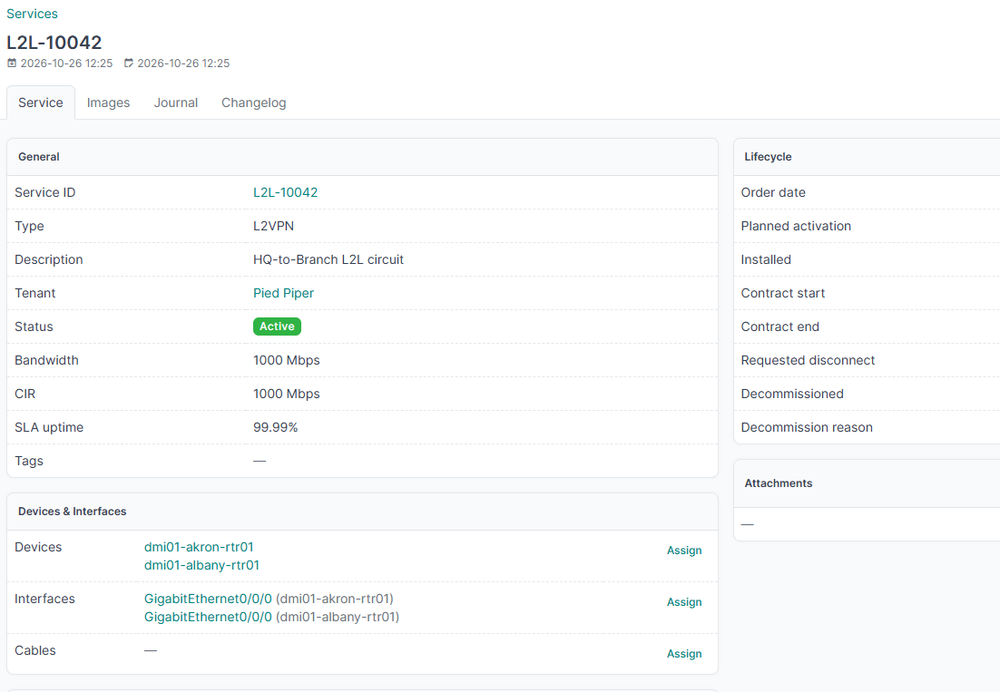

# L2VPN: point-to-point L2L circuit

**Scenario:** a Layer 2 circuit connecting two sites for a customer, e.g. extending their LAN between a headquarters and a branch office. Layer 2 means no IP address lives on the service itself.

## 1. Create the service

```bash
curl -s -X POST "$NETBOX_URL/api/plugins/services/" \
  -H "Authorization: Token $NETBOX_TOKEN" \
  -H "Content-Type: application/json" \
  -d '{
    "type": "l2vpn",
    "service_id": "L2L-10042",
    "description": "HQ-to-Branch L2L circuit",
    "status": "active",
    "bandwidth": 1000,
    "cir": 1000,
    "sla_uptime_percent": "99.99",
    "tenant": 3,
    "order_date": "2026-09-01",
    "installed": "2026-09-20",
    "contract_start": "2026-09-20",
    "contract_end": "2027-09-20"
  }'
```

`tenant` is the tenant's numeric ID — look it up via `GET /api/tenancy/tenants/?name=<name>` if you don't already have it. `bandwidth`/`cir` are in Mbps.

The response includes the new service's `id` (its PK) — you'll need it for the next step. Say it comes back as `42`.

## 2. Attach the inventory

Open `/plugins/services/42/` in the browser. On the left-hand cards:

1. **Devices** → Assign → select the two PE routers that terminate the circuit (one at each site).
2. **Interfaces** → Assign → select the specific interface on each device that carries the circuit.
3. **Cables/XConnects** → Assign → select the physical cable/cross-connect records, if you track them in NetBox.
4. **VLANs** → Assign → select the VLAN the circuit trunks, if applicable (some L2L designs are untagged).

Leave **Prefixes**, **IP Addresses**, **VRFs**, and **ASNs** empty — this is Layer 2, there's no routed address space on the service itself.

## Result

The service detail page now shows the two devices, their interfaces, and (if assigned) the cable and VLAN under **Delivery**, alongside the lifecycle dates and SLA you set via the API. If another service — say a CDN node — rides on top of this L2L, record that under **Dependencies** → **Assign** on the *other* service's "Depends on" field, pointing back at `L2L-10042`.


