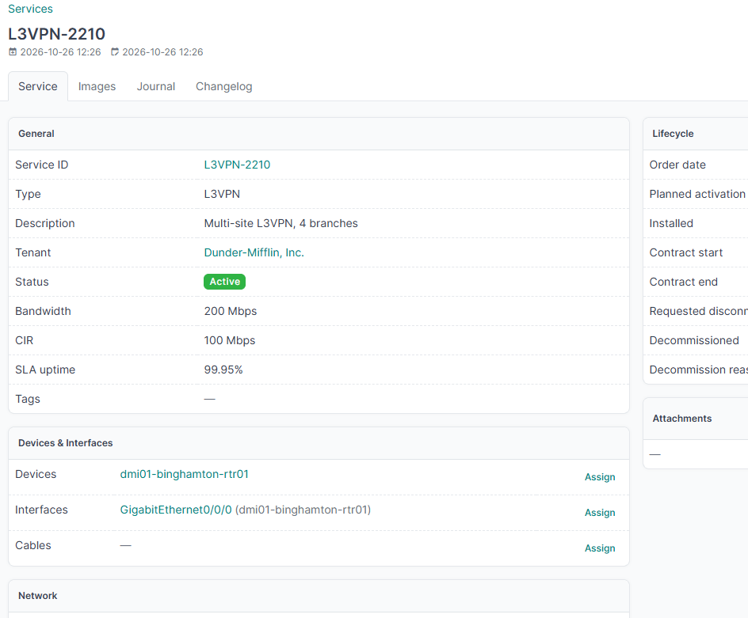

# L3VPN: routed VPN over MPLS

**Scenario:** a Layer 3 VPN connecting several customer sites over your MPLS core, each site exchanging routes with you via BGP or static routing, isolated in its own VRF.

## 1. Create the service

```bash
curl -s -X POST "$NETBOX_URL/api/plugins/services/" \
  -H "Authorization: Token $NETBOX_TOKEN" \
  -H "Content-Type: application/json" \
  -d '{
    "type": "l3vpn",
    "service_id": "L3VPN-2210",
    "description": "Multi-site L3VPN, 4 branches",
    "status": "active",
    "bandwidth": 200,
    "cir": 100,
    "sla_uptime_percent": "99.95",
    "tenant": 3,
    "order_date": "2026-08-01",
    "installed": "2026-08-25",
    "contract_start": "2026-08-25",
    "contract_end": "2027-08-25"
  }'
```

Suppose this comes back with `id: 43`.

## 2. Attach the inventory

Open `/plugins/services/43/`:

1. **Devices** → Assign → the PE routers at each customer site.
2. **Interfaces** → Assign → the CE-facing interface on each PE.
3. **Prefixes** → Assign → the customer's routed prefix(es) carried over the VPN.
4. **IP Addresses** → Assign → the point-to-point or loopback addresses used for PE-CE peering, if you track those individually rather than just the prefix.
5. **VRFs** → Assign → the VRF this customer's traffic is isolated in.
6. **Route Targets** → Assign → the import/export route targets used to leak routes between sites in the VPN.

## Result

The service now ties together every site's router and interface, the customer's address space, and the VRF/route-target plumbing that keeps their traffic isolated from other customers sharing the same MPLS core — all from one place, instead of having to reconstruct it from the VRF's own page.


